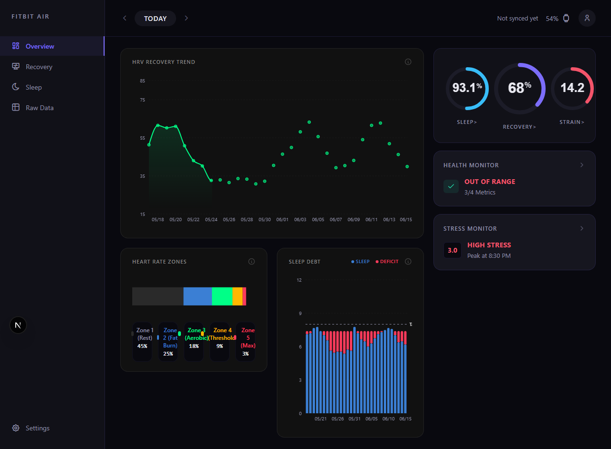

<div align="center">

# ⌚ Fitbit Air — Android Companion Client

<p><strong>Mobile companion and Health Connect sync hub for the <a href="https://github.com/Kahaan83/Fitbit-air-dashboard">Fitbit Air biometric analytics ecosystem</a>.</strong></p>

[-3DDC84?style=for-the-badge&logo=android&logoColor=white)](https://developer.android.com)
[](https://kotlinlang.org)
[](https://developer.android.com/jetpack/compose)
[](https://github.com/Kahaan83/Fitbit-air-dashboard)
[](LICENSE)

<br />


<p><em>The full-stack Fitbit Air desktop dashboard fed by wearable & Health Connect telemetry.</em></p>

<br />

[**Desktop Dashboard Repository ↗**](https://github.com/Kahaan83/Fitbit-air-dashboard)

</div>

---

## 🚀 Overview

**Fitbit Air Android** is designed as the mobile companion in the **Fitbit Air** biometric platform. While the [web dashboard](https://github.com/Kahaan83/Fitbit-air-dashboard) provides comprehensive desktop recovery and sleep stage analytics, this Android repository serves as the native mobile client and gateway for on-device health telemetry.

The project is architected to ingest biometric records (Heart Rate, HRV, SpO₂, Sleep Stages, and Skin Temperature) directly from **AndroidX Health Connect** and stream them to the central analytics pipeline.

---

## 🏛️ Ecosystem Role & Architecture Specification

```
┌─────────────────────────┐
│ Wearable / Smartwatch   │ (Pixel Watch, Fitbit, Wear OS)
└────────────┬────────────┘
             │ Sync
             ▼
┌─────────────────────────┐
│ Android Health Connect  │ (On-device encrypted health storage)
└────────────┬────────────┘
             │ HealthConnectClient
             ▼
┌────────────────────────────────────────────────────────┐
│ Fitbit Air Android Client (This Repository)            │
│ ├── Local Room DB (Encrypted offline cache)            │
│ ├── Gemini Generative AI (Contextual wellness insights)│
│ └── Export / Sync Dispatcher (FastAPI / Cloud Relay)   │
└────────────────────────────┬───────────────────────────┘
                             │
                             ▼
┌────────────────────────────────────────────────────────┐
│ Fitbit Air Web Dashboard (Next.js 16 + FastAPI)        │
│ └── https://github.com/Kahaan83/Fitbit-air-dashboard   │
└────────────────────────────────────────────────────────┘
```

---

## 🛠️ Technical Stack & Specifications

| Component | Target Specification |
|---|---|
| **Language & Platform** | Kotlin 2.0 (JVM 17 Target, compileSdk 35, minSdk 26) |
| **UI Framework** | Modern Jetpack Compose with Material 3 |
| **Data Ingestion** | AndroidX Health Connect Client (`androidx.health.connect:connect-client`) |
| **Dependency Injection** | Dagger Hilt with KSP compiler |
| **Local Persistence** | Room Database (with KSP schema generation) & Encrypted DataStore |
| **Data Visualization** | Vico Compose M3 hardware-accelerated time-series charts |
| **Local Assistant** | Google Generative AI Android SDK (`gemini-generativeai`) |

---

## 📂 Repository Structure

```bash
Fitbit-air-app/
├── app/
│   ├── src/main/java/com/kahaan/fitbitairdashboard/
│   │   ├── MainActivity.kt      # Android entry point with edge-to-edge Compose shell
│   │   └── ui/theme/            # Material 3 tokens, colors, typography
│   ├── build.gradle.kts         # Target SDK 35, Compose build features
│   └── proguard-rules.pro
├── assets/                      # Ecosystem preview & architecture graphics
├── LICENSE                      # MIT License
└── README.md
```

---

## 🚀 Getting Started

### Prerequisites

- **Android Studio Ladybug (2024.2+)** or newer
- **JDK 17**
- Physical Android device (API 26+) or Emulator with **Google Play Services** and **Health Connect** enabled

### Building Locally

```bash
# Clone the repository
git clone https://github.com/Kahaan83/Fitbit-air-app.git
cd Fitbit-air-app

# Build debug APK via Gradle wrapper
./gradlew assembleDebug
```

---

## 🔗 Related Ecosystem Repositories

- **[Fitbit Air Dashboard (Web & Backend)](https://github.com/Kahaan83/Fitbit-air-dashboard):** The primary Next.js + Python FastAPI dashboard for biometric visualization and Google Health API analysis.

---

## 👤 Author

**Kahaan Shah**
- Portfolio: [kahaanshah.in](https://kahaanshah.in)
- GitHub: [@Kahaan83](https://github.com/Kahaan83)
- LinkedIn: [linkedin.com/in/kahaan-shah-842095334](https://www.linkedin.com/in/kahaan-shah-842095334/)

---

## 📄 License

This project is licensed under the MIT License — see the [LICENSE](LICENSE) file for details.
